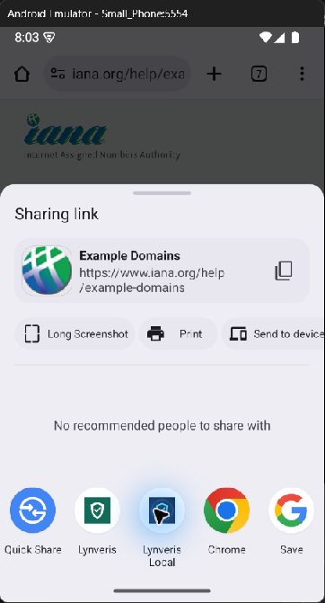
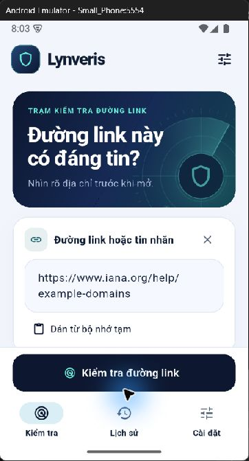

# Minh chứng Lynveris W05

Ngày kiểm tra 12/11/2026. Phạm vi checkpoint là Must #2 theo V4, API kết hợp
đặc trưng URL, mô hình và nguồn tin đe dọa để trả mức nguy cơ cùng lý do.
Chrome Android được dùng làm kênh gửi URL có sẵn.

## Nhận URL từ Chrome

URL đối chứng là trang tài liệu IANA.

Ảnh được chụp bằng Computer Use trên Small_Phone trong phiên hỗ trợ.
Lượt nhận Share được quan sát trực tiếp. Lượt kiểm tra Android rộng bị
gián đoạn khi giả lập mất kết nối. Kết quả kiểm tra API bên dưới được
thu riêng bằng HTTP tới backend đang chạy trên Windows.

## Eval API thật

[Kết quả từng ca và thời điểm](evidence/w05/api-checks.json)

18/18 tình huống đạt kỳ vọng chức năng, gồm trang đối chứng, mẫu Google,
URL mô phỏng và đầu vào không hỗ trợ. Đây là bộ kiểm tra hợp đồng API.
Phép đánh giá nghiên cứu trên tập đã khóa được giữ riêng.

| Đầu vào | Kết quả quan sát |
| --- | --- |
| IANA và AWS Academy | no_signs, model ready và hai nguồn not_found |
| Mẫu thử phishing của Google | high, nguồn detected |
| Thương hiệu trước dấu @ | caution, hostname thực tế được xác định |
| Google chưa cấu hình ở dịch vụ QA | insufficient, nguồn partial |

Script tái lập là [eval_w05.py](../scripts/eval_w05.py). Script cần backend
local tại cổng 8000 và dịch vụ QA chưa có khóa Google tại cổng 8003.
Các khóa hiện có chỉ ở môi trường local. Artifact model và dữ liệu nghiên cứu
được lưu riêng trên máy phát triển.

## Trình bày trực tiếp

Mở Chrome trên Android Emulator, chia sẻ trang IANA vào Lynveris Local,
xác nhận URL và bấm kiểm tra. API cần đang chạy ở máy phát triển.
Địa chỉ backend trong emulator là 10.0.2.2:8000.

Tài liệu này cung cấp ảnh và log minh chứng của checkpoint.
Phần đo người dùng gia đình và so sánh nghiên cứu tiếp tục theo lịch V4.
