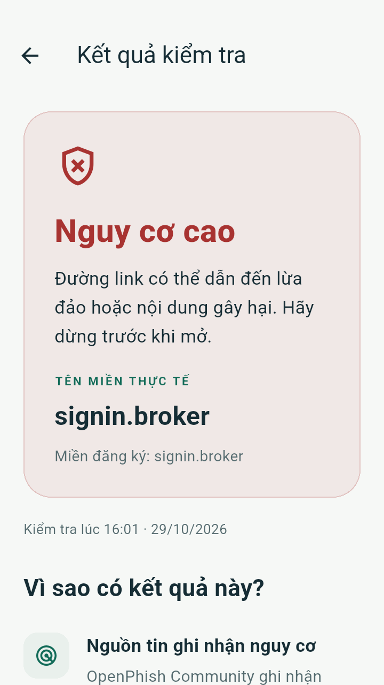
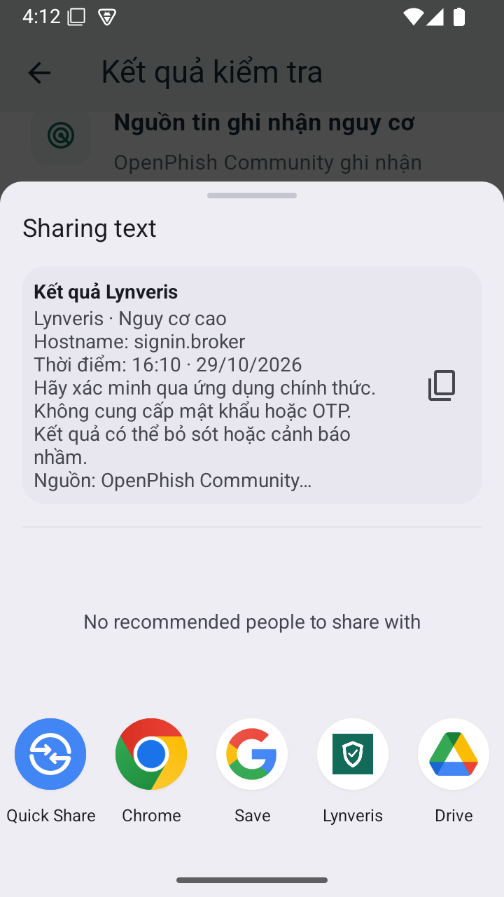

# Minh chứng Lynveris W06

Ngày kiểm tra **19/11/2026**, giờ Việt Nam. Checkpoint gồm tính năng Must #3
nhận/chia sẻ kết quả trên Android, kiểm thử và eval chẩn đoán. Mã nguồn hiện tại
đã có ba Must theo V4: pipeline dữ liệu và baseline, API kết hợp URL/model/nguồn,
Flutter nhận link và chia sẻ kết quả cùng thống kê tối thiểu khi đồng ý.

## Kết quả đã chạy

| Nhóm | Kết quả | Bằng chứng |
| --- | --- | --- |
| Backend tự động | 132 đạt | [JUnit XML](evidence/w06/backend-tests.xml) |
| Flutter unit và widget | 20 đạt | [Log](evidence/w06/flutter-tests.txt) |
| API và PostgreSQL thật | 9/9 đạt | [Response từng ca](evidence/w06/live-checks.json) |
| Eval chẩn đoán có 10 lỗi đã quan sát | 17/30 đạt, 13 chưa đạt | [30 bản ghi](evidence/w06/eval-summary.json) |
| Phân tích 10 bản ghi lỗi | Đã đối chiếu nhãn, điểm mô hình, quyết định và ghi nhận xét cho từng ca | [Nhận xét](evidence/w06/review-10.json) |

[Phiên bản nền và phạm vi làm việc](evidence/w06/verification.json) ghi rõ các
test Flutter chạy trên working tree local có thay đổi giao diện chưa commit.
Các test unit/widget dùng fixture để kiểm tra logic. Nhóm live dùng model,
nguồn và PostgreSQL thật. Hai nhóm được báo tách riêng.

## Tính năng thứ ba trên Android

Hai ảnh dưới là ảnh chụp trực tiếp từ Android, kế thừa ngày **29/10/2026**,
ở hai lần kiểm tra khác nhau: màn kết quả lúc 16:01, bảng chia sẻ lúc 16:10.
Cả hai hiển thị hostname `signin.broker` và mức nguy cơ cao trong các lượt cũ.
Mức cảnh báo và trạng thái nguồn khi đó không đại diện cho kết quả hiện tại.
Ảnh gốc giữ nguyên nội dung, không có lớp con trỏ của máy tính.
Hash và đường dẫn ảnh gốc nằm trong [thông tin bằng chứng](evidence/w06/verification.json).
Các lượt kiểm tra và tổng hợp bằng chứng có AI hỗ trợ; phạm vi được ghi theo từng nhóm.





Lượt Chrome → Lynveris ngày **12/11/2026** có
[ảnh phía Chrome](evidence/w05/chrome-share.png) và
[ảnh Lynveris nhận URL](evidence/w05/lynveris-nhan-link.png).
Ngày 19/11, lượt điều khiển native đã dừng khi người dùng nhấn Esc, trước khi
xác nhận mới toàn bộ luồng. Không coi test widget là một lượt native mới.

## API và dữ liệu thật ngày 19/11

- IANA trả `no_signs`, Google và OpenPhish đều `not_found`.
- Mẫu thử phishing chính thức của Google trả `high`, nguồn `detected`.
- URL có thương hiệu trước dấu `@` trả `caution`, hiển thị hostname thật.
- Đầu vào rỗng và giao thức `file` trả HTTP 422.
- Dịch vụ QA thiếu khóa Google trả `insufficient`, nguồn `partial`.
- Tạo đúng một sự kiện bằng token mới, đọc từ PostgreSQL và xóa bằng token đó;
  tập ID có sẵn trước/sau bằng nhau. Token và chuỗi kết nối không nằm trong log.

## Eval có chủ đích chọn ca khó

Model **HistGradientBoosting 20261029T135127Z**, 20 đặc trưng `url-v1`, ngưỡng
**0.7446086243613848** được giữ nguyên. Chín tệp nghiên cứu đã khóa đều khớp
checksum sau lượt eval. Tập test nghiên cứu không được chạy lại hoặc chỉnh sửa.

Nguồn là validation PhreshPhish đã lưu, revision
`eca603e0ecd4f698f8d4d226c088659e72681239`.
Script duyệt 400 dòng đầu và ghi nhận 46 lỗi so với nhãn nguồn. Cohort cố định
trước lượt gọi API gồm 10 benign và 10 phish đầu theo thứ tự lưu, cộng 10 lỗi
khác đã quan sát. Nhóm đầu đạt 17/20; nhóm lỗi lặp lại đạt 0/10.

Phép chấm: HTTP 200, `high`/`caution` khớp nhãn phish hoặc `no_signs` khớp
nhãn benign; `insufficient` hay lỗi HTTP đều không đạt. Tra nguồn tắt ở 30 ca
để kiểm tra riêng URL/model/quy tắc. Đích URL không được truy cập. Nhãn nguồn
phản ánh lịch sử thu thập, không phải kết luận hiện tại về website.

**17/30 (56,67%) chỉ là tỷ lệ đạt trên cohort chẩn đoán được chọn khó.** Đây
không phải ước lượng độ chính xác thực địa hoặc thay thế benchmark đã khóa.
H1/H2 chưa được xác nhận. Không điều chỉnh ngưỡng theo những ca này.

Ba lỗi tiêu biểu là cảnh báo nhầm Moodle R09, bỏ sót đường dẫn trên hosting
chung R03 và bỏ sót gần ngưỡng N18. Nhận xét nguyên nhân là giả thuyết từ trace,
chưa phải phép đo đóng góp của đặc trưng. Bảng nhận xét có AI hỗ trợ ghi nhãn,
điểm số và quyết định của từng ca để phục vụ đối chiếu và giải thích khi vấn đáp.
Trạng thái xác nhận đọc tay độc lập được lưu riêng theo từng bản ghi.

## Tái lập trong môi trường local

Script [eval_w06.py](../scripts/eval_w06.py) có hai lệnh `prepare` và `run`.
`prepare` từ chối ghi đè cohort đã có. Cần dữ liệu validation, artifact model
local và backend ở `127.0.0.1:8000`. Artifact nghiên cứu không được đưa lên repo.

Script [check_w06_live.py](../scripts/check_w06_live.py) cần thêm dịch vụ QA
cổng 8003 thiếu khóa Google, kết nối PostgreSQL trong môi trường local và quyền
đọc bảng `research_events`. Dịch vụ QA không được dùng cấu hình sản xuất.

```powershell
$env:PYTHONPATH='backend'
.venv\Scripts\python.exe -m pytest -q backend/tests
.venv\Scripts\python.exe scripts/eval_w06.py prepare
.venv\Scripts\python.exe scripts/eval_w06.py run
.venv\Scripts\python.exe scripts/check_w06_live.py
```

Flutter chạy `flutter test --no-pub --reporter expanded` tại thư mục mobile.
Backend trên emulator được gọi bằng `10.0.2.2:8000`. Bằng chứng này là ảnh và
log của checkpoint local; chưa có địa chỉ dịch vụ công khai để dùng từ Internet.

## Tài liệu tự học và nguồn dữ liệu

Đã vận dụng tài liệu chính thức Anthropic
[Define success criteria and build evaluations](https://platform.claude.com/docs/en/test-and-evaluate/develop-tests)
và [Demystifying evals for AI agents](https://www.anthropic.com/research/demystifying-evals-for-ai-agents).
Chưa có bản công khai xác minh được của đúng tài liệu Hitachi Năm 4 do học phần
nêu; không gán nội dung Anthropic thành nội dung Hitachi.

PhreshPhish: [dataset](https://huggingface.co/datasets/phreshphish/phreshphish),
CC BY 4.0. Bản minh chứng biến đổi 30 bản ghi validation thành hostname, hash URL,
nhãn và kết quả API. Đường dẫn URL đầy đủ được giữ local.
Minh chứng khóa học Cisco/AWS được theo dõi riêng.
