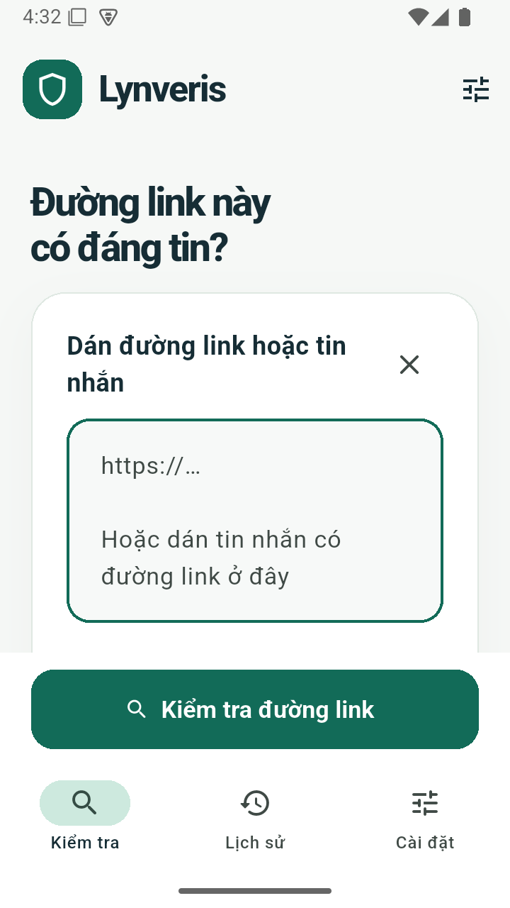
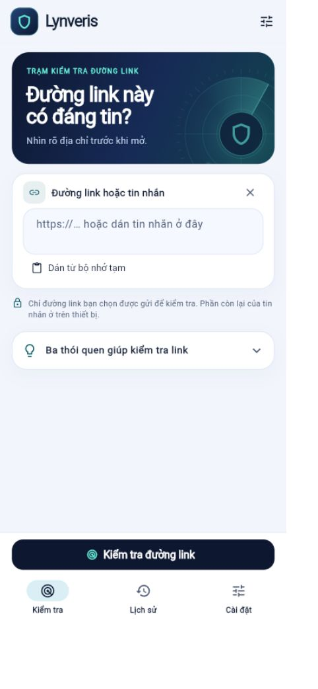
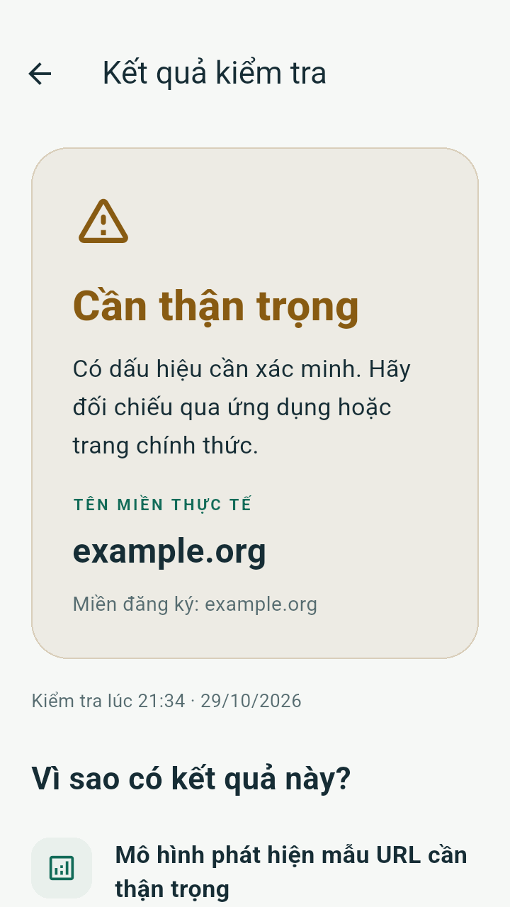
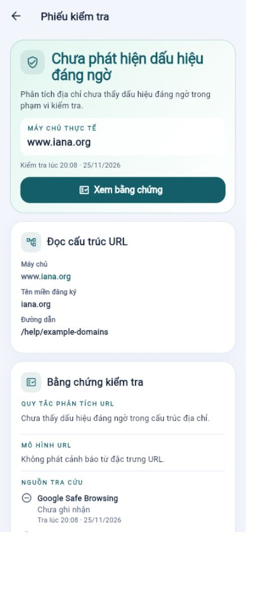
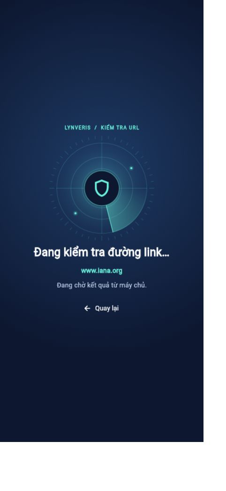
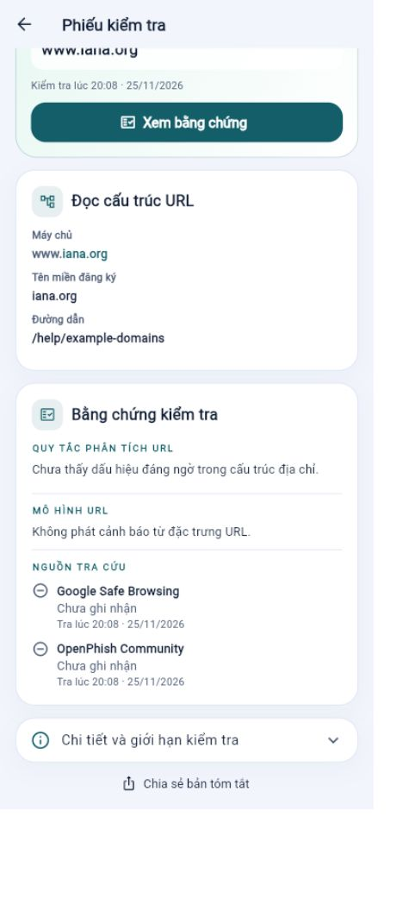

# Minh chứng Lynveris W07

Ngày kiểm tra **25/11/2026**, giờ Việt Nam. Phạm vi tuần này là bảo mật,
hoàn thiện UX, Docker/CI, đo 5 NFR và đóng băng các tính năng hiện có.

## Bảo mật đã kiểm chứng

| Biện pháp | Liên hệ khóa học | Kết quả thật |
| --- | --- | --- |
| Quyền tối thiểu và sở hữu dữ liệu | AWS Academy Cloud Architecting v3, Module 3 Securing Access | Role PostgreSQL có SELECT/INSERT/DELETE; không superuser, CREATE hoặc TRUNCATE. DDL trái quyền bị từ chối SQLSTATE 42501. Mã sở hữu khác và chuỗi SQL không xóa được bản ghi thử. |
| Phân đoạn dịch vụ và bảo vệ tiến trình | AWS Academy Cloud Architecting v3, Module 7 Creating a Networking Environment | Compose không publish cổng DB, API bind loopback; API UID 10001 và root filesystem chỉ đọc đã kiểm chứng trong container. Đây là áp dụng nguyên tắc, không phải triển khai AWS IAM/VPC trên máy local. |
| Giới hạn đầu vào và riêng tư | OWASP Top 10 A01/A02/A05:2025 | Body 16 KiB, lượt 31 bị HTTP429, đầu vào sai HTTP422 không phản chiếu chuỗi riêng. Phản hồi 413/429 có no-store sau khi sửa lỗi quan sát được. |

[9 kiểm tra bảo mật và 5 NFR](evidence/w07/quality-checks.json) ·
[Log đọc nhanh](evidence/w07/security-proof.txt) ·
[Test âm tính chạy được](../backend/tests/test_security_w07.py).

Thống kê thử dùng token mới, đọc trực tiếp từ PostgreSQL rồi xóa đúng một sự kiện.
Tập ID trước/sau bằng nhau (0 bản ghi có sẵn ở lượt này). Không dùng token của
người dùng, không ghi URL/tin nhắn/token thô vào bảng. Kiểm tra DDL được rollback;
không reset schema hoặc xóa dữ liệu có sẵn.

## UX dựa trên góp ý thật

Ba góp ý lấy từ chính chủ dự án trong cuộc trò chuyện trước W07: cảnh báo khó
phân biệt, muốn thấy nhiều bằng chứng, và muốn có trạng thái quét rõ ràng.
Đây là **ba góp ý từ một người dùng**, không phải khảo sát ba người hay pilot H2.
[Trích đoạn và thay đổi tương ứng](evidence/w07/ux-feedback.json).

| Góp ý | Hoàn thiện trong phạm vi đã có |
| --- | --- |
| Kết quả nào cũng có cảnh báo | Kết luận, lý do và nút hành động riêng theo trạng thái; giới hạn đặt riêng. |
| Cần nhiều thông tin dễ hiểu | Tách máy chủ, miền đăng ký, đường dẫn; quy tắc URL, model và từng nguồn cùng thời điểm. |
| Muốn có hiệu ứng lúc quét | Radar, hostname đang kiểm tra và trạng thái chờ thật; hỗ trợ giảm chuyển động. |

Ảnh trước là native Android ngày 29/10. Ảnh sau là Flutter Web ở khung mobile
390×844 ngày 25/11, gọi backend/model/nguồn thật. URL ở hai ảnh kết quả khác
nhau; hình dùng đối chiếu bố cục, không dùng chứng minh thay đổi độ chính xác.

| Trước | Sau |
| --- | --- |
|  |  |
|  |  |

[Lượt trình duyệt thật](evidence/w07/browser-checks.json) đã quan sát IANA trả
`no_signs`, Google và OpenPhish `not_found` riêng biệt. Tắt tra nguồn được hiện
đúng là đang tắt. Đây không phải lượt kiểm tra mới Android Sharesheet.

## Năm NFR

| NFR | Mục tiêu định trước | Cách đo | Kết quả 25/11 |
| --- | --- | --- | --- |
| NFR01 độ trễ | p95 ≤500 ms | 5 warm-up, 100 POST tuần tự loopback, model thật, tra nguồn ngoài tắt; nearest-rank p95 | 2,850 ms, đạt |
| NFR02 tính ổn định | ≥99% HTTP200 | Cùng 100 request hợp lệ, đếm mã trạng thái | 100/100 =100%, đạt |
| NFR03 riêng tư | 0 URL/token thô trong bản ghi mới | Tạo một sự kiện trong PostgreSQL, đọc trường và đối chiếu marker/token, dọn đúng sự kiện | 0 trường hợp, đạt |
| NFR04 chống lạm dụng | 30 lượt đầu được xử lý, lượt 31 HTTP429 trong 60s | App test riêng cấu hình mặc định 30, đổi X-Forwarded-For giữa các request | 30 HTTP200, lượt 31 HTTP429, đạt |
| NFR05 khả năng đọc | 0 lỗi layout ở 320×640, chữ150% | Widget test mở phiếu, đọc hostname, chạm nút dấu hiệu, kiểm exception | 0 lỗi, đạt |

Máy đo Windows 11, i7-12650H, RAM7,7GiB, Python3.10.11. Dịch vụ QA cổng8007
có ngưỡng600/min riêng để lấy mẫu hiệu năng; chính sách30/min được đo riêng.
Độ trễ này chưa bao gồm mạng Internet, nguồn ngoài, tải đồng thời hay thời gian
hiệu ứng giao diện. 100% là thành công HTTP trong mẫu, không phải uptime24/7
hoặc độ chính xác nhận diện. Widget test dùng fixture cho bố cục.

Model20261029T135127Z, ngưỡng và 9 tệp nghiên cứu khóa đều giữ nguyên.
Eval chẩn đoán W06 vẫn17/30 trên bộ chọn nhiều lỗi; không dùng tốc độ hay
test phần mềm để thay thế chỉ số mô hình, H1 hoặc H2.

## Docker và CI

Xem [README](../README.md#docker-và-postgresql),
[Dockerfile](../backend/Dockerfile), [Compose](../compose.yaml) và
[workflow](../.github/workflows/ci.yaml).

GitHub Actions chạy test thật khi push/PR: lint, 136 backend test, PostgreSQL
migrations, build/run Compose, kiểm tra container, Flutter analyze/test,
build APK và web. JUnit và Compose JSON được lưu trong artifact.

[Lần build/run và kiểm tra Compose](https://github.com/leminhdinhtien-creator/Lynveris/actions/runs/45619727936)
đã qua 9/9 kiểm tra, gồm UID10001, root filesystem chỉ đọc và DB không publish.
[JSON container](evidence/w07/compose-checks.json) được tải từ artifact CI.
Checkout CI không có model thật nên API thể hiện `unavailable/insufficient`.
Model thật được đo riêng trên Windows; không tạo model giả để CI trông đầy đủ.

Máy Windows chưa có Docker/WSL distribution; không ghi nhận build Docker local.
Compose hiện dùng role DB của cấu hình phát triển. Bản triển khai Internet cần
role runtime riêng, HTTPS, model mount chỉ đọc và secret runtime theo tài liệu phát hành.

## Đóng băng phạm vi

[Danh sách tính năng chốt](feature-freeze-v0.9.md) ·
[Tag v0.9](https://github.com/leminhdinhtien-creator/Lynveris/tree/v0.9).
`v0.9` là mốc học phần W07; phiên bản gói Android đang là1.2.0.
Sau mốc này không thêm nguồn, resolver, chatbot hoặc nghiệp vụ mới.
Các sửa lỗi, bảo mật, kiểm thử và tài liệu vẫn nằm trong phạm vi đã chốt.

## Tự học đã áp dụng

- [A01 Broken Access Control](https://top10.owasp.org/2025/A01_2025-Broken_Access_Control/): kiểm quyền sở hữu khi xóa và role tối thiểu.
- [A02 Security Misconfiguration](https://top10.owasp.org/2025/A02_2025-Security_Misconfiguration/): cấu hình CORS, loopback, container không root và secret ngoài image.
- [A05 Injection](https://top10.owasp.org/2025/A05_2025-Injection/): SQLAlchemy ràng buộc giá trị; chuỗi SQL trong header không trở thành câu lệnh.
- [Docker Get started](https://docs.docker.com/get-started/) và [GitHub Actions quickstart](https://docs.github.com/en/actions/get-started/quickstart): Dockerfile, migration trước API, healthcheck và test theo push.

AI hỗ trợ triển khai, chạy kiểm tra và tổng hợp báo cáo; kết quả không được
nhận là thử nghiệm người dùng diện rộng. Chưa có đánh giá % hoàn thành của GVHD.
